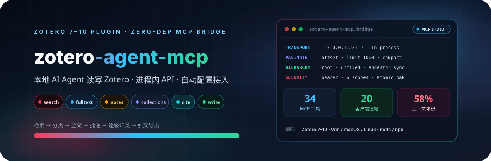

<p align="center">
  
</p>

# Zotero-Agent-MCP

面向本地 AI Agent 的 Zotero 7–10 全能 MCP 插件与零依赖 stdio 桥接器。在 Zotero 内置 HTTP 服务（`127.0.0.1:23119/zotero-agent-mcp/`）上运行进程内直调接口，提供 **34 个 MCP 工具**、**20 种客户端自动接入**、完整分页遍历与内建路由 Skill，无需绕行原生 `/api/**` 或处理写操作授权弹窗。

适用场景：文献全库检索与增量同步、PDF/EPUB 全文分页读取、批注与子笔记提取、批量元数据建库与归类整理、引文样式渲染与条目导出。

## 能力矩阵（34 端点 / 34 工具）

插件在 Zotero 进程内直接访问核心对象模型与数据库索引，所有读写能力均以统一作用域与标准分页协议对外暴露：

| 能力域 | HTTP 端点 ⇄ MCP 工具 | 作用域 |
|---|---|---|
| 状态与库发现 | `GET /ping` ⇄ `zotero_ping`，`/libraries` ⇄ `zotero_libraries` | public / read |
| 集合树与查找 | `/collections`、`/collections/search` ⇄ `zotero_collections`、`zotero_search_collections` | read |
| 集合与根库遍历 | `/collection/:key/items` ⇄ `zotero_get_collection_items` | read |
| 条件检索 | `/search` ⇄ `zotero_search`（支持纯 `tag`/`item_type`/`collection` 筛选） | read |
| 最近条目与回收站 | `/items/recent`、`/items/trash` ⇄ `zotero_recent`、`zotero_get_trash` | read |
| 元数据与子内容 | `/item/:key`、`/item/:key/children` ⇄ `zotero_get_item`、`zotero_get_children` | read |
| 全文索引读写 | `/item/:key/fulltext`、`POST /item/:key/fulltext/set` ⇄ `zotero_get_fulltext`、`zotero_set_fulltext` | fulltext |
| 高亮与批注 | `/item/:key/annotations` ⇄ `zotero_get_annotations` | annotations |
| 引文与格式化导出 | `/item/:key/cite` ⇄ `zotero_cite`（CSL / BibTeX / RIS / CSL-JSON / CSV） | export |
| 附件与本地路径 | `/item/:key/file`、`/item/:key/path` ⇄ `zotero_get_item`、`zotero_get_attachment_path` | files |
| 条目增改删与挂载 | `POST /item`、`/item/:key/update|delete|attach` ⇄ `zotero_add_item`、`zotero_update_item`、`zotero_delete_item`、`zotero_attach_file` | write |
| 集合归属与结构管理 | `POST /item/:key/collections`、`/collection*` ⇄ `zotero_set_item_collections`、`zotero_create_collection`、`zotero_update_collection`、`zotero_delete_collection` | write |
| 笔记与标签管理 | `/tags`、`POST /note`、`/tag`、`/tags/delete` ⇄ `zotero_get_tags`、`zotero_add_note`、`zotero_add_tag`、`zotero_delete_tags` | read / write |
| 保存检索与增量同步 | `/searches*`、`/search/:key/items`、`/schema`、`/versions` ⇄ `zotero_get_searches`、`zotero_create_search`、`zotero_update_search`、`zotero_delete_search`、`zotero_run_search`、`zotero_get_schema`、`zotero_versions` | read / write |

标准数据流：

```text
探活(ping) -> 发现(libraries / collections) -> 检索或分页拉取(search / collection_items) -> 细读(item / fulltext / annotations) -> 写库归类(add / update / set_item_collections) -> 引文导出(cite)
```

分页、层级与全库遍历约定（v0.6.3）：

- **统一分页与精简投影**：`zotero_search`、`zotero_recent`、`zotero_get_collection_items`、`zotero_get_trash`、`zotero_run_search`、`zotero_search_collections`、`zotero_get_tags` 均支持 `offset` 与 `limit`（常规上限 `500`，传 `compact: true` 时上限提升至 `1000`；`zotero_get_tags` 上限 `5000` 并支持 `query` 过滤），响应固定包含 `total`、`offset`、`limit`、`hasMore`、`nextOffset` 与确定性排序（`dateModified DESC, key DESC`）。
- **根库、未分类与递归浏览**：`zotero_get_collection_items` 支持 `key="root"` / `"all"`（遍历全库所有常规条目）及 `key="unfiled"`（未归类条目），支持 `recursive=true` 与 `"Parent / Child"` 路径匹配；`zotero_collections` 返回每个集合的直接条目数 `itemCount`、含子集合的去重总数 `totalItemCount`，以及顶层 `totalItems` 和 `unfiledItems`。
- **子分类自动向上级同步归类**：通过 `zotero_add_item`、`zotero_update_item` 或 `zotero_set_item_collections`（`add`/`replace`）将文献归入子分类时，自动向上逐级加入所有祖先集合直至第一层级分类，保证上下层文献数量一致（需禁用时传 `includeAncestors: false`）。
- **多库与错误码**：`library` 参数支持 `user`（默认）、数字 `libraryID` 或 `all`（检索）；错误统一返回 `{error, message}`（`401` 未鉴权 / `403` 作用域关闭 / `404` 不存在 / `400` 参数错误 / `409` 只读库 / `415` 无法提取 / `503` 服务禁用）。

## 安装与初始化

### 1. 安装 Zotero 插件

从 [GitHub Releases](https://github.com/JingYangYuan/zotero-agent-mcp/releases/tag/release) 下载最新版 `zotero-agent-mcp.xpi`，或从源码本地打包：

```bash
git clone https://github.com/JingYangYuan/zotero-agent-mcp.git
cd zotero-agent-mcp
bash tools/build.sh
```

在 Zotero 中依次打开 **工具 → 插件 → 齿轮图标 → Install Plugin From File…**，选择 `build/zotero-agent-mcp.xpi` 安装。插件通过 `update.json` 自动检查后续版本更新。

### 2. 启动方式与工具集档位

桥接脚本随插件启动自动释放至 `<Zotero 数据目录>/zotero-agent-mcp/zotero-agent-mcp.mjs`，也可直接通过 `npx` 启动：

| 启动方式 | 执行命令 | 适用场景 |
|---|---|---|
| 本地 `node` 直启（默认） | `node "<Zotero 数据目录>/zotero-agent-mcp/zotero-agent-mcp.mjs"` | 可访问本地文件系统的全部客户端，握手延迟约 25–33 ms |
| `npx` 零配置拉起 | `npx --prefer-offline -y zotero-agent-mcp --token <令牌>` | 沙盒客户端或不想绑定本机路径时；未传 `--token` 时自动回退读取数据目录下的 `token` 文件 |
| 精简核心工具集 | 在参数追加 `--tools=core`（或设置 `ZOTERO_AGENT_TOOLS=core`） | 仅暴露 13 个高频核心工具，用于严控上下文预算的客户端 |

### 3. 直接 HTTP 调用示例

```bash
curl http://127.0.0.1:23119/zotero-agent-mcp/ping
curl -H "Authorization: Bearer <令牌>" "http://127.0.0.1:23119/zotero-agent-mcp/collection/root/items?compact=true&limit=200&offset=0"
curl -H "Authorization: Bearer <令牌>" "http://127.0.0.1:23119/zotero-agent-mcp/item/<KEY>/fulltext?maxChars=20000"
curl -X POST -H "Authorization: Bearer <令牌>" -H "Content-Type: application/json" \
  -d '{"itemType":"journalArticle","title":"平台用工研究","creators":[{"name":"张三"}],"fields":{"date":"2024","publicationTitle":"社会学研究"},"collections":["研究子专题"],"tags":["agent"]}' \
  http://127.0.0.1:23119/zotero-agent-mcp/item
```

## 客户端适配（20 个）

插件启动时自动扫描已安装的客户端并合并写入 `zotero-agent` 配置，同时保持与设置面板中令牌的同步：

| 客户端 | 配置文件路径 | 配置格式 |
|---|---|---|
| Claude Code | `~/.claude.json` | `mcpServers` JSON |
| Claude Desktop | `~/Library/Application Support/Claude/claude_desktop_config.json`（Win: `%APPDATA%\Claude\…`） | `mcpServers` JSON |
| Cursor | `~/.cursor/mcp.json` | `mcpServers` JSON |
| Codex CLI | `~/.codex/config.toml` | `[mcp_servers.zotero-agent]` TOML |
| Gemini CLI | `~/.gemini/settings.json` | `mcpServers` JSON |
| Antigravity | `~/.gemini/config/mcp_config.json` / `~/.gemini/antigravity/mcp_config.json` | `mcpServers` JSON |
| WorkBuddy | `~/.workbuddy/mcp.json` | `mcpServers` JSON |
| GitHub Copilot CLI | `~/.copilot/mcp-config.json` | `mcpServers` JSON |
| Factory (Droid) | `~/.factory/mcp.json` | `mcpServers` JSON |
| Kimi Code | `~/.kimi-code/mcp.json` / `~/.kimi/mcp.json` | `mcpServers` JSON |
| Oh-My-Pi (OMP) | `~/.omp/agent/mcp.json` | `mcpServers` JSON |
| CommandCode | `~/.commandcode/mcp.json` | `mcpServers` JSON |
| Amp | `~/.config/amp/settings.json`（Win: `%APPDATA%\amp\settings.json`） | `amp.mcpServers` JSON |
| ZCode | `~/.zcode/cli/config.json` | `mcp.servers` JSON |
| VS Code | `~/Library/Application Support/Code/User/mcp.json` 或 `.vscode/mcp.json` | `servers` JSON |
| OpenCode | `~/.config/opencode/opencode.json` | `mcp`（`type: local`）JSON |
| Pi agent | `~/.pi/agent/mcp.json` | `mcpServers` JSON |
| Trae | `%APPDATA%\Trae\User\mcp.json` / `Trae CN` / `~/.trae/mcp.json` | `mcpServers` JSON |
| Windsurf | `~/.codeium/windsurf/mcp_config.json` | `mcpServers` JSON |
| Kiro | `~/.kiro/settings/mcp.json` | `mcpServers` JSON |

扩展与手动接入说明：

- **面板一键管理**：设置 → **Zotero-Agent-MCP** → **接入 agent**，已安装客户端自动置顶并标注 `已接入 / 未接入 / 未安装 / 令牌过期`，内置「未覆盖客户端手动接入」卡片（一键复制通用 `node` / `npx` JSON 与预览）及真实 `node` **连接测试**。
- **自定义注册表与片段**：在 `<Zotero 数据目录>/zotero-agent-mcp/clients.local.json` 中按 `id` 追加或覆盖客户端条目；全部客户端的 `node`/`npx` 参考片段会导出在 `agent-configs.json`。

## 工作机制与安全模型

1. **服务注册**：Zotero 启动时在内置 HTTP server 注册 `/zotero-agent-mcp/*` 端点并绑定至 `127.0.0.1`，读取 `enabled` 偏好持久化运行开关。
2. **资源释放与配置同步**：自动将最新桥接脚本、Skill 与客户端注册表写入数据目录，按 `merge-only` 规则合并已安装客户端配置（仅增改 `zotero-agent` 节点，首次写入前保留 `.zotero-agent-mcp.bak` 备份，写入采用原子临时文件替换）。
3. **桥接调用**：AI 客户端通过零依赖 Node stdio 桥接转发 JSON-RPC 请求至本地 HTTP 端点，默认加载全部 34 个工具并带 MCP 读写/破坏性 annotations 提示。
4. **作用域与审计**：默认开启六大功能作用域，可在设置面板高级设置中逐项开关或设置库白名单；请求与写入事件按日/大小轮转记录至 `~/Zotero/zotero-agent-mcp-audit.jsonl`（令牌仅保留前 4 位脱敏展示）。

### 设置面板概览

| 面板区块 | 提供的能力 |
|---|---|
| 状态栏 | 版本号 · 运行状态 · 当前实际 `baseUrl`（跟随 Zotero 端口） |
| 服务控制 | 持久化启用开关 · 访问令牌（掩码显示 / 复制 / 确认后重新生成） |
| 接入 agent | 20 个客户端逐行状态与 `[接入]` / `[更新]` / `[撤销]` · 全部接入 · 连接测试 · 自动同步 · 安装/撤销 Skill · 手动接入复制卡 |
| 高级设置 | 六个功能作用域开关 · 库白名单 · 审计日志开关与查看 · 打开桥接目录 · 复制通用 `curl` |

## 性能与测试

经 `tools/bench.mjs` 与回归脚本验证的典型指标：

| 指标 | 实测表现 |
|---|---|
| `tools/list` 上下文占用（全量 34 工具） | `11960 B`（约 `2.99k` tokens，占 `v0.5.1` 基线 `20619 B` 的 `58.0%`，低于 `60%` 上限预算） |
| `--tools=core` 核心工具集（13 工具） | 约 `5.4 KB` |
| 单次本地 HTTP 调用耗时 | `0–1 ms` |
| 桥接冷启动握手（`initialize → tools/list`） | macOS Zotero 空闲约 `25 ms` / 并发约 `33 ms`；Windows CI 基线约 `82–145 ms` |

运行全套离线与真机校验：

```bash
bash tools/build.sh                                # 构建 xpi 并检查内嵌源码同步
node --check plugin/zotero-agent-mcp.js
node --check plugin/bootstrap.js
node --check plugin/prefs.js
node --check bridge/zotero-agent-mcp.mjs
node tools/test_windows_paths.mjs                  # Windows 路径规范化与原样写入测试（235 项）
node tools/test_config_merge.mjs                   # 客户端 JSON / TOML 合并与撤销幂等测试（49 项）
node tools/test_mcp_pagination.mjs                 # 分页、compact 模式、祖级归类与桥接转发测试
node tools/bench.mjs --runs=3                      # 握手延迟与 tools/list 字节预算校验
```

真机全端点 E2E（需 Zotero 运行并携带令牌）：

```bash
TOKEN=$(cat ~/Zotero/zotero-agent-mcp/token)
RUN_NOTE_TEST=1 CREATE_ITEM_TEST=1 MANAGE_TEST=1 bash tools/test_api.sh "$TOKEN"
ZOTERO_AGENT_TOKEN="$TOKEN" CREATE_ITEM_TEST=1 MANAGE_TEST=1 node tools/test_bridge.mjs
```

## 故障排查

- **提示插件不兼容或文件损坏**：确认从 [Releases](https://github.com/JingYangYuan/zotero-agent-mcp/releases/tag/release) 下载完整 `.xpi` 安装，且 `manifest.json` 的 `update_url` 与 `strict_max_version`（`10.*`）未被篡改。
- **Agent 连不上本地服务**：打开面板点击「连接测试」；常见问题包括 Zotero 未开启、令牌过期未同步、客户端使用旧路径或本机未安装 Node.js（≥ 18）。
- **工具返回 `401 unauthorized` 或 `403 scope_disabled`**：重新触发「全部接入」或「更新」同步新令牌；`403` 请到面板「高级设置」打开对应作用域（如 `write` / `fulltext`）。
- **只看到 13 个工具**：当前客户端启动参数带了 `--tools=core`，移除该参数即可恢复全部 34 个工具。
- **`npx` 拉起缓慢或失败**：优先使用面板默认写入的本地 `node` 直启配置；Windows 用户注意不要跨缓存代理盲目重试，确认使用 `npx --prefer-offline -y zotero-agent-mcp`。

## 仓库目录结构

```text
zotero-agent-mcp/
├── .github/workflows/           # CI 验证与 tag 自动构建发布（GitHub Releases + npm OIDC）
├── bridge/
│   └── zotero-agent-mcp.mjs     # 零依赖 Node MCP stdio 桥接器（34 工具）
├── docs/
│   └── banner.svg               # 仓库视觉横幅
├── plugin/
│   ├── manifest.json            # Zotero 插件清单与自动更新入口
│   ├── bootstrap.js             # 插件生命周期钩子
│   ├── zotero-agent-mcp.js      # HTTP 路由、分页引擎、客户端配置器与核心逻辑
│   ├── prefs.xhtml / prefs.js   # Zotero 设置面板 UI
│   ├── clients.json             # 20 个客户端路径与配置格式注册表
│   ├── icons/                   # 插件图标资源（SVG + PNG）
│   ├── skill/SKILL.md           # 内置 Agent Zotero 操作路由 Skill
│   └── *-source.js              # build.sh 生成的内置脚本资源
├── tools/
│   ├── build.sh                 # 打包 XPI 与生成内置 source 模块
│   ├── bench.mjs / bench-baseline.json
│   ├── test_windows_paths.mjs   # Windows 路径展开与写入回归
│   ├── test_config_merge.mjs    # 客户端配置合并幂等回归
│   ├── test_mcp_pagination.mjs  # 分页、祖级集合同步与桥接参数校验
│   ├── test_bridge.mjs          # 真机 MCP E2E 测试
│   ├── test_api.sh              # 真机 HTTP 全端点测试
│   └── install-skill.sh / make-icons.py
├── package.json                 # npm 包清单（zotero-agent-mcp）
├── CHANGELOG.md                 # 版本更新日志
├── DESIGN.md                    # 设计决策与架构说明
└── README.md
```

## License

MIT License
